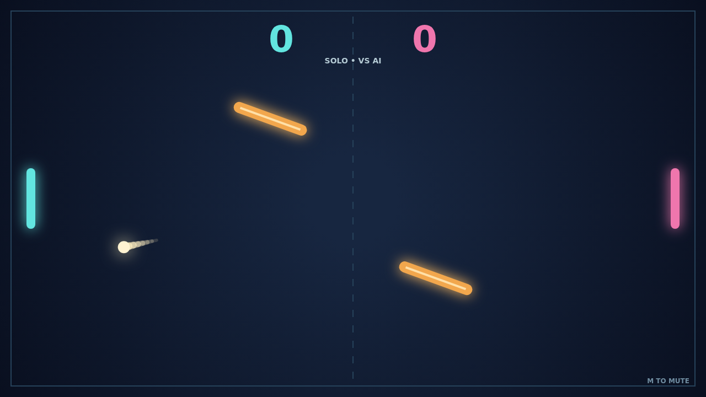

# Carom

Two paddles, one ball, and a field that refuses to stay still. Carom turns a familiar duel into a game of angles: every return can bend, and every opening can become a bank shot.

A match begins with the ball waiting at center court. Guide your paddle to meet it, then move through the impact to add spin. The glowing trail shows the curve you gave it as the ball races across the field.

Two bars sway and rotate in the middle. A shot that looks safe can ricochet off one and arrive from a new direction. Learn their rhythm, catch a tilted face, and send the ball around your rival's paddle.

Play Solo against the AI or challenge someone beside you in Versus. The first to 11 needs a two-point lead, so a close match can turn on one last spinning return.

